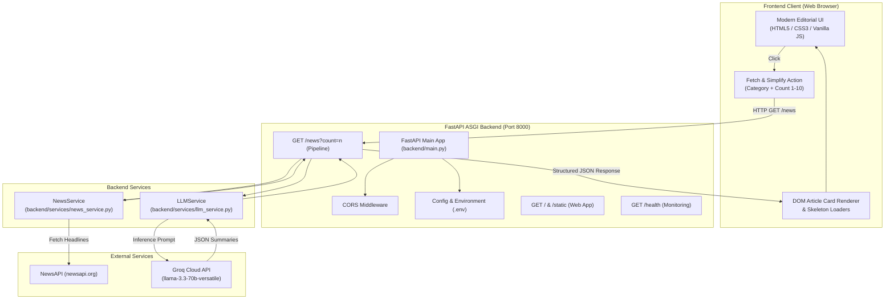

# FinNews AI – Financial News Simplifier 📈🤖

[](https://fastapi.tiangolo.com)
[](https://groq.com)
[](https://python.org)
[](LICENSE)

**FinNews AI** is an AI-powered full-stack web application designed to make financial news accessible, digestible, and understandable for everyone. Financial journalism often contains dense terminology, market jargon, and intricate economic commentary that poses high barriers for non-specialists. 

FinNews AI solves this problem by fetching real-time financial news articles via **NewsAPI** and using Groq's high-speed inference engine powered by Meta's **Llama 3.3 70B** (`llama-3.3-70b-versatile`) to automatically distill complex stories into clear, plain-English summaries, actionable key takeaways, and definitions of financial terms.

---

## 🌟 Key Features

- **Real-Time Financial Ingestion**: Fetches top market and business headlines across financial categories using NewsAPI.
- **Ultra-Fast LLM Simplification**: Powered by Groq's LPU-accelerated `llama-3.3-70b-versatile` model with structured JSON outputs.
- **Jargon Translation Engine**: Automatically identifies and defines complex terms (e.g., *Yield Curve Inversion*, *Basis Points*, *Capex*, *Hawkish*, *Carry Trade*) in plain English.
- **Actionable Bullet Takeaways**: Provides 2–3 concise bullet points explaining what each event means for investors, consumers, and the economy.
- **Dual Execution Mode**: Works seamlessly in **Live Mode** with real API keys, and includes an intelligent zero-configuration **Demo/Fallback Mode** for instant local testing and grading.
- **Modern Dark-Themed Editorial UI**: Responsive interface inspired by modern financial terminals, featuring category filters, article count selectors, skeleton loaders, and one-click clipboard copying.
- **Production-Ready REST Backend**: FastAPI server with asynchronous endpoints, CORS support, comprehensive error handling, and interactive OpenAPI documentation (`/docs`).

---

## 👥 User Scenarios

| Scenario | User | Need | How FinNews AI Helps |
| :--- | :--- | :--- | :--- |
| **Scenario 1** | **Retail Investor** | Wants to understand stock market fluctuations without reading 2,000-word reports. | Generates 2-sentence market summaries and bullet points explaining price drivers and potential risks. |
| **Scenario 2** | **Finance Student** | Studying interest rate changes, inflation, and Federal Reserve policy. | Translates complex economic jargon (e.g. *quantitative tightening*, *core PCE*) into easy-to-understand definitions. |
| **Scenario 3** | **Business Professional** | Needs a 2-minute executive briefing on market developments before morning meetings. | Fetches multi-article summaries categorized by topic with actionable takeaways. |
| **Scenario 4** | **Market Observer** | Tracking volatile geopolitical or commodity swings in real time. | Delivers rapid summaries on oil, crypto, and currency shifts with negligible latency. |

---

## 🏛️ System Architecture



---

## 🧠 AI Model Selection: Why Llama 3.3 70B Versatile?

We evaluated leading open-weights models available on Groq Cloud:
1. **Llama 3.3 70B Versatile (`llama-3.3-70b-versatile`) [Selected]**:
   - Offers near-frontier intelligence on economic and technical text comprehension.
   - Preserves high factual consistency and numerical precision (essential for rates, percentages, and financial metrics).
   - Achieves sub-second inference speeds (~250–350 tokens/sec) on Groq LPUs.
   - 128k context window allows multi-article batch context without truncation.
2. **Llama 3.1 8B Instant**:
   - Ultra-fast, but occasionally struggles with nuanced financial terminology and subtle macroeconomic distinctions.
3. **Mixtral 8x7B**:
   - Strong reasoning, but slower than Llama 3.3 70B on structured JSON adherence.

---

## 📁 Project Directory Structure

```
naacc/
├── backend/
│   ├── __init__.py             # Backend package initializer
│   ├── config.py               # Settings loader (reads .env with safe fallbacks)
│   ├── models.py               # Pydantic schemas (SimplifiedArticle, NewsResponse, HealthResponse)
│   ├── main.py                 # FastAPI application, CORS, static routes, and endpoints
│   └── services/
│       ├── __init__.py         # Services package initializer
│       ├── news_service.py     # NewsAPI client, article validation, and fallback datasets
│       └── llm_service.py      # Groq SDK client (llama-3.3-70b-versatile) & prompt engine
├── frontend/
│   ├── index.html              # Modern, accessible semantic HTML5 single-page interface
│   ├── css/
│   │   └── styles.css          # Responsive dark-mode editorial styling (Bloomberg/FT style)
│   └── js/
│       └── app.js              # Asynchronous fetch, dynamic DOM rendering, clipboard utilities
├── tests/
│   ├── __init__.py             # Tests package initializer
│   └── test_api.py             # 10 Pytest test cases validating all routes and parameter bounds
├── .env.example                # Example environment variable template
├── .env                        # Local environment configuration (never commit secrets)
├── .gitignore                  # Git ignore rules for venv, env, and caches
├── requirements.txt            # Python package dependencies
└── README.md                   # Comprehensive project documentation
```

---

## 🚀 Getting Started

### 1. Prerequisites
- **Python 3.10+** (Tested on Python 3.12)
- **Pip** package manager

### 2. Clone or Navigate to the Project
```bash
cd d:\naacc
```

### 3. Create and Activate Virtual Environment
**On Windows:**
```powershell
python -m venv finnews-env
.\finnews-env\Scripts\activate
```

**On macOS / Linux:**
```bash
python3 -m venv finnews-env
source finnews-env/bin/activate
```

### 4. Install Dependencies
```bash
pip install -r requirements.txt
```

### 5. Configure API Keys (Optional for live mode)
Copy the example environment file:
```bash
cp .env.example .env
```
Open `.env` and fill in your keys:
```env
# Groq API Key (Get free key at https://console.groq.com/keys)
GROQ_API_KEY=gsk_your_groq_api_key_here
GROQ_MODEL=llama-3.3-70b-versatile

# NewsAPI Key (Get free key at https://newsapi.org/register)
NEWS_API_KEY=your_news_api_key_here

# App settings
HOST=127.0.0.1
PORT=8000
ENVIRONMENT=development
```

> **Note**: If API keys are not supplied, FinNews AI operates in **Curated Demo Mode**, serving high-fidelity financial articles and pre-computed summaries so you can test the entire workflow immediately without requiring third-party credentials.

---

## 💻 Running the Application

Start the backend server using Uvicorn:
```powershell
# Using the active virtual environment:
uvicorn backend.main:app --host 127.0.0.1 --port 8000 --reload
```

Once running:
- **Web Application Interface**: Open [http://127.0.0.1:8000](http://127.0.0.1:8000) in any modern browser.
- **Interactive Swagger Documentation**: Open [http://127.0.0.1:8000/docs](http://127.0.0.1:8000/docs).
- **Alternative ReDoc UI**: Open [http://127.0.0.1:8000/redoc](http://127.0.0.1:8000/redoc).

---

## 📡 API Endpoints Reference

### 1. Root & Interface
- **Route**: `GET /`
- **Description**: Serves the single-page HTML5 frontend interface.

### 2. System Health & Diagnostics
- **Route**: `GET /health`
- **Sample Response**:
  ```json
  {
    "status": "healthy",
    "version": "1.0.0",
    "app_name": "FinNews AI – Financial News Simplifier",
    "groq_configured": true,
    "newsapi_configured": true,
    "model": "llama-3.3-70b-versatile",
    "environment": "development"
  }
  ```

### 3. Fetch & Simplify News
- **Route**: `GET /news`
- **Query Parameters**:
  - `count` *(integer, optional, default: 5, min: 1, max: 10)*: Number of articles to process.
  - `category` *(string, optional)*: Filter by topic (`Markets`, `Economy`, `Tech Stocks`, `Commodities`, `Crypto`, `Currencies`).
- **Sample Response**:
  ```json
  {
    "success": true,
    "count": 1,
    "mode": "live",
    "model": "llama-3.3-70b-versatile",
    "articles": [
      {
        "title": "Federal Reserve Holds Benchmark Rate Steady at 5.25%-5.50%",
        "source": "Financial Times",
        "author": "Colby Smith",
        "published_at": "2026-09-29T14:30:00Z",
        "url": "https://www.ft.com/central-banks",
        "category": "Economy",
        "original_description": "The Federal Open Market Committee voted unanimously to maintain the federal funds target range...",
        "summary": "The US Federal Reserve decided not to change interest rates, keeping them at their highest level in two decades. Policymakers are waiting for more proof that consumer prices are stably under control before cutting borrowing costs.",
        "key_takeaways": [
          "Borrowing costs for home mortgages and credit cards will remain elevated.",
          "High-yield savings accounts and CDs continue paying high interest.",
          "Central bankers remain cautious to avoid an inflation rebound."
        ],
        "simplified_terms": {
          "Benchmark Rate": "The interest rate commercial banks charge each other to borrow money overnight.",
          "Core Inflation": "Price change measurement excluding volatile items like groceries and gasoline."
        }
      }
    ]
  }
  ```

---

## 🧪 Automated Testing

FinNews AI includes a comprehensive test suite covering route responses, count boundary conditions, parameter validation, and CORS compliance.

To run the automated tests:
```powershell
.\finnews-env\Scripts\python -m pytest tests -v
```

**Test Suite Coverage**:
- `test_root_serves_html`: Verifies HTML frontend is served at root.
- `test_api_info`: Verifies `/api` returns correct system metadata.
- `test_health_endpoint`: Validates configuration reporting and 200 OK.
- `test_news_endpoint_default_count`: Confirms default retrieval returns 5 articles with complete schemas.
- `test_news_endpoint_custom_count`: Confirms customized article count (`count=3`).
- `test_news_endpoint_count_boundary_one`: Confirms minimum boundary handling (`count=1`).
- `test_news_endpoint_invalid_count_underflow`: Confirms `count=0` is rejected with HTTP 422.
- `test_news_endpoint_invalid_count_overflow`: Confirms `count=15` is rejected with HTTP 422.
- `test_news_endpoint_category_filtering`: Validates topic-based filtering.
- `test_cors_headers`: Verifies CORS response headers for web client security.

---

## 🚢 Production Deployment

### 1. Running with Production ASGI Server
```bash
uvicorn backend.main:app --host 0.0.0.0 --port 8000 --workers 4
```

### 2. Docker Deployment (Optional)
Create a `Dockerfile`:
```dockerfile
FROM python:3.12-slim
WORKDIR /app
COPY requirements.txt .
RUN pip install --no-cache-dir -r requirements.txt
COPY . .
EXPOSE 8000
CMD ["uvicorn", "backend.main:app", "--host", "0.0.0.0", "--port", "8000"]
```

---

## 📜 License

This project is licensed under the MIT License - see the LICENSE file for details.
